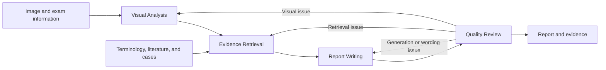

# RadClaw

RadClaw is a multi-agent medical imaging report generation system. It combines visual analysis, evidence retrieval, report writing, and quality review to produce structured reports and readable **Findings** and **Impression** sections, with links to supporting image and retrieved evidence.

The current implementation supports chest X-ray, chest CT, abdominal CT, and brain MRI datasets. It connects to a vision-language model through an OpenAI-compatible API and provides command-line runners for individual cases, batch generation, execution traces, and ablation studies.

## How it works



| Agent | Tools | Responsibilities |
| --- | ---: | --- |
| Visual Analysis | 8 | Select slices, crop regions, enhance images, render windows, compose panels, annotate images, generate probes, and link visual evidence. |
| Evidence Retrieval | 7 | Standardize observations, look up concepts, search literature and cases, score evidence, detect conflicts, and summarize support. |
| Report Writing | 5 | Build findings and impressions, link supporting evidence, assemble the report, and render report text. |
| Quality Review | 6 | Check visual, evidence, internal, and guideline consistency; attribute issues; and collect simulated human feedback. |

The agents share a `PipelineState` containing image evidence, retrieved evidence, the report, and review issues. The orchestrator reruns the earliest stage responsible for an issue and all downstream stages. `pipeline.max_iterations` limits the total number of iterations, including the first pass; the configured value is `3`.

The execution engine streams events for agent activity, tool calls, status updates, and final results. It also supports concurrent execution of eligible tools and context compaction.

## Project layout

```text
radclaw/
├── config/settings.yaml        # Model, data, retrieval, and agent settings
├── data/
│   ├── knowledge/              # Local terminology and knowledge files
│   ├── indexes/                # FAISS and BM25 indexes
│   └── raw/                    # Ontology sources and parsed records
├── docs/                       # Handover and technical notes
├── hf/                         # Local dataset snapshots
├── models/                     # Local model assets
├── hallucination_detection/    # Claim-level report evaluation
├── scripts/
│   ├── run_single.py           # One CheXpert case
│   ├── run_batch.py            # CheXpert batch generation
│   ├── run_trace.py            # CheXpert generation with detailed traces
│   ├── run_ablation.py         # Multiple datasets and four pipeline modes
│   ├── evaluate_chest_xray.py
│   ├── evaluate_chest_ct.py
│   ├── evaluate_abdominal_ct.py
│   ├── evaluate_brain_mri.py
│   └── ingest/                 # Ontology parsing and index construction
├── src/
│   ├── agents/                # Agent builders and prompts
│   ├── core/                  # Orchestrator, execution loop, and baselines
│   ├── data/                  # Dataset loaders and session image storage
│   ├── hooks/                 # Quality checks
│   ├── kb/                    # Embedding, terminology, and PubMed clients
│   ├── llm/                   # OpenAI-compatible model client
│   ├── metrics/               # Bundled GREEN implementation
│   ├── report/                # Report schema
│   ├── tools/                 # Visual, evidence, report, and review tools
│   └── web/                   # Web API
├── tests/
├── pyproject.toml
└── output/                    # Created by generation and evaluation runs
```

The separate `retrieval_service/`, `serve_sglang.sh`, and `scripts/serve_model.sh` described in the handover are not included in this checkout. The remote retrieval client is included; its server must be deployed separately.

## Getting started

### 1. Install the project

Use Python **3.10 or newer** and run the following commands from the project root:

```bash
python -m venv .venv
source .venv/bin/activate
python -m pip install -e .
python -m pip install rank-bm25 httpx
```

`rank-bm25` is required for BM25 index construction and loading. It is not currently declared in `pyproject.toml`; `httpx` is used directly by retrieval tools and is also installed through the OpenAI client dependency.

Optional dependency groups:

```bash
python -m pip install -e ".[ingest]"  # Ontology parsing
python -m pip install -e ".[eval]"    # ROUGE and BERTScore dependencies
python -m pip install -e ".[dev]"     # pytest and pytest-asyncio
```

The `eval` extra does not install every evaluation metric. Additional requirements are listed under [Evaluation](#evaluation).

A hosted model endpoint avoids running the generation model locally. Local model serving requires a separately installed inference server and hardware appropriate to the model. Terminology embeddings can run on CPU or CUDA; model-based evaluation metrics may require additional GPU memory and downloaded weights.

### 2. Configure model access and local paths

Edit [config/settings.yaml](config/settings.yaml) for your environment. The checked-in file contains deployment-specific values, including `embedding.device: "cuda:1"` and a retrieval endpoint at `http://localhost:8081`.

The following is a configuration excerpt to merge into that file. Replace the model identifier and paths with your own values:

```yaml
model:
  path: "YOUR_SERVED_MODEL_ID"
  base_url: "http://localhost:9000/v1"
  api_key: "EMPTY"  # Replace for an authenticated endpoint
  max_tokens: 8192
  temperature: 0.7
  max_retries: 5
  retry_base_delay_ms: 500

data:
  chexpert_path: "./hf/Doorad/CheXpert-plus-RRG"
  knowledge_dir: "./data/knowledge"
  indexes_dir: "./data/indexes"
  raw_dir: "./data/raw"
  output_dir: "./output"

embedding:
  model_name: "./models/pritamdeka/S-PubMedBert-MS-MARCO"
  device: "cpu"  # Or an available device such as cuda:0
  batch_size: 64

pubmed:
  enabled: true
  api_key: ""  # Optional NCBI API key
  max_results_per_query: 5

snomed:
  mode: "local"

remote_kb:
  base_url: ""  # Set to your retrieval server URL to enable it
  timeout: 60.0

pipeline:
  max_iterations: 3
```

`model.path` is sent as the API's model identifier; the pipeline does not load those model weights itself. The endpoint must support image input, streaming chat completions, and tool calls for the agent pipeline. The handover describes SGLang deployment with Qwen3.5-35B-A3B; use an existing compatible endpoint or provision model serving separately.

For an unauthenticated local endpoint, check availability with:

```bash
curl http://localhost:9000/v1/models
```

Use the same embedding model for building indexes and querying them. `embedding.model_name` also accepts the model identifier `pritamdeka/S-PubMedBert-MS-MARCO` when it is available through the model cache or download access.

Other controls in the settings file include `agents.*.max_turns`, per-agent generation parameters, `hooks.*` quality thresholds, and `limits.*` context and image-evidence limits. Runner scripts accept `--settings PATH` for an alternative YAML file and `--output-dir DIR` for output placement. Relative paths are resolved from the working directory.

### 3. Prepare a dataset

Place a dataset snapshot at its configured path. For the first run, the default CheXpert loader expects a local CheXpert-plus-RRG snapshot containing the `findings_section` configuration and `valid` partition. It joins impressions from `impression_section` when available.

The runner option `--split findings_section` selects the dataset configuration/report section for the chest X-ray loaders; it is not a general train/validation/test selector. The CheXpert loader uses `valid` internally.

### 4. Run a case

```bash
python scripts/run_single.py \
  --index 0 \
  --settings config/settings.yaml \
  --output-dir output/single
```

This runs all four agents, prints the generated and reference reports, and writes `output/single/sample_0_findings_section.json`. For an evaluation-ready result with reference text and evidence artifacts, use the trace or ablation runner described below.

## Knowledge and retrieval

RadClaw uses three knowledge layers:

| Layer | Source | Purpose |
| --- | --- | --- |
| Terminology | Local RadLex and SNOMED indexes; optional SNOMED API mode | Normalize observations and resolve medical concepts. |
| Literature | Remote guideline search and optional PubMed E-utilities queries | Retrieve supporting guidelines and articles. |
| Cases | Remote case search | Retrieve similar reports from a separately indexed case collection. |

The configured terminology assets live under `data/knowledge/terminology/` and `data/indexes/`. To rebuild RadLex indexes from `data/raw/radlex_parsed.json`:

```bash
python scripts/ingest/build_indexes.py \
  --source radlex \
  --parsed-dir data/raw \
  --output-dir data/indexes \
  --device cpu
```

Use `--source snomed` for `snomed_parsed.json`. Both paths build FAISS and BM25 indexes. If starting from ontology source files, parse them first with [parse_radlex_owl.py](scripts/ingest/parse_radlex_owl.py) or [parse_snomed_rf2.py](scripts/ingest/parse_snomed_rf2.py); use `--help` to inspect input options. The index builder uses the default S-PubMedBert-MS-MARCO model and has its own command-line options rather than reading the main settings file.

For remote retrieval, set `remote_kb.base_url` to a deployed service exposing:

| Endpoint | Purpose |
| --- | --- |
| `GET /health` | Service readiness and loaded indexes. |
| `POST /search/guidelines` | Guideline search. |
| `POST /search/cases` | Similar-case search. |

Search requests contain `query`, `category`, and `max_results`. Categories include `chest_xray`, `chest_ct`, `brain_ct`, `brain_mri`, and `abdominal_ct`. The handover describes the external service's FAISS/BM25 retrieval and reciprocal rank fusion, along with its data formats and deployment configuration.

When `remote_kb.base_url` is empty, guideline search is skipped and case retrieval returns no matches. PubMed can still supply literature evidence when enabled. Setting `pubmed.enabled: false` disables that source as well. Guideline and PubMed searches run concurrently when both are configured.

## Running experiments

### Choose a runner

| Script | Dataset support | Output |
| --- | --- | --- |
| `run_single.py` | CheXpert | One result JSON and console comparison. |
| `run_batch.py` | CheXpert | Flat per-sample result JSON files with reference text and a batch summary. |
| `run_trace.py` | CheXpert | Per-sample reports, references, timelines, agent traces, and images. |
| `run_ablation.py` | All datasets below | Per-sample summaries, results, timelines, available images, and a batch summary. |

```bash
# Detailed traces for selected CheXpert cases
python scripts/run_trace.py --indices 0,1,2 --output-dir output/traces

# CheXpert batch: --end is exclusive; --end -1 processes the remaining dataset
python scripts/run_batch.py --start 0 --end 10 --output-dir output/batch

# Full pipeline on selected cases from another dataset
python scripts/run_ablation.py \
  --mode full --dataset mimic_cxr --indices 0,1,2 \
  --output-dir output/mimic_full
```

### Supported datasets

Use the following canonical values with `run_ablation.py --dataset`. Set the corresponding path under `data` in the settings file.

| Modality | Dataset | `--dataset` | Configuration key |
| --- | --- | --- | --- |
| Chest X-ray | CheXpert-plus-RRG | `chexpert` | `chexpert_path` |
| Chest X-ray | IU-Xray-RRG | `iu_xray` | `iu_xray_path` |
| Chest X-ray | MIMIC-CXR-RRG | `mimic_cxr` | `mimic_cxr_path` |
| Chest X-ray | Open-I | `openi` | `openi_path` |
| Chest CT | CT-RATE | `ct_rate` | `ct_rate_path` |
| Chest CT | RadGenome-ChestCT | `radgenome` | `radgenome_path` |
| Abdominal CT | Merlin | `merlin` | `merlin_path` |
| Abdominal CT | AbdomenAtlas | `abdomenatlas` | `abdomenatlas_path` |
| Brain MRI | MR-RATE | `mr_rate` | `mr_rate_path` |
| Brain MRI | RadGenome-Brain MRI | `radgenome_brain_mri` | `radgenome_brain_mri_path` |

Loaders in [src/data](src/data) provide a common sample interface with an image, reference text, and exam metadata. CT/MRI loaders require the prepared data layout expected by each loader, including report manifests and referenced image volumes; a model or dataset name alone is not sufficient.

### Ablation modes

| Mode | Pipeline |
| --- | --- |
| `direct` (B1) | One vision-language model call without tools. |
| `visual_only` (B2) | Visual Analysis → Report Writing. |
| `retrieval_only` (B3) | Evidence Retrieval → Report Writing; the retrieval agent receives the image to infer observations. |
| `full` | All four agents with quality-review feedback. |

```bash
python scripts/run_ablation.py --mode direct --indices 0,1,2 --output-dir output/ablation_direct
python scripts/run_ablation.py --mode visual_only --indices 0,1,2 --output-dir output/ablation_visual
python scripts/run_ablation.py --mode retrieval_only --indices 0,1,2 --output-dir output/ablation_retrieval
python scripts/run_ablation.py --mode full --indices 0,1,2 --output-dir output/ablation_full
```

The default mode is `direct`. Omitting `--indices` processes all samples exposed by the selected loader. The ablation runner resumes by skipping cases whose `sample_<index>/summary.json` already exists. Use a separate output directory for each dataset, mode, and configuration to avoid mixing results or skipping cases from a previous experiment.

## Outputs and traces

A trace run produces the following layout; image files and the final result are written when available:

```text
output/traces/
├── batch_summary.json
└── sample_0/
    ├── summary.json
    ├── result.json
    ├── event_timeline.json
    ├── trace_<iteration>_visual_analysis.json
    ├── trace_<iteration>_evidence_retrieval.json
    ├── trace_<iteration>_report_writing.json
    ├── trace_<iteration>_quality_review.json
    ├── image_index.json
    └── images/
```

`summary.json` contains `natural_language_report`, `ground_truth`, timing, and execution statistics. `result.json` contains the pipeline result, including structured findings and impressions, evidence, and review information. The ablation runner uses the same per-sample summary/result layout but does not write the individual `trace_<iteration>_<agent>.json` files.

Inspect `remaining_issues` as well as `review_passed`: the current orchestrator accepts an existing structured report with warnings when the iteration limit is reached, setting `review_passed` to `true` even if issues remain.

`run_single.py` prints the reference report but does not save `ground_truth` in its result JSON. Use batch, trace, or ablation output for reference-based evaluation.

## Evaluation

The current evaluation entry points are separated by modality. The older `scripts/evaluate.py` command in the handover is no longer present.

Every evaluator supports BLEU-4, ROUGE-L, METEOR, and evidence coverage metrics. Additional metrics are:

| Script | Additional metric selectors |
| --- | --- |
| [evaluate_chest_xray.py](scripts/evaluate_chest_xray.py) | `chexbert_f1`, `green`, `ratescore` |
| [evaluate_chest_ct.py](scripts/evaluate_chest_ct.py) | `clinical_f1` (CheXbert-derived label scores) |
| [evaluate_abdominal_ct.py](scripts/evaluate_abdominal_ct.py) | `bertscore`, `umls` |
| [evaluate_brain_mri.py](scripts/evaluate_brain_mri.py) | `bertscore`, `ratescore`, `radgraph` |

For text-overlap metrics, install the evaluation extra and the additional packages used by the scripts:

```bash
python -m pip install -e ".[eval]"
python -m pip install sacrebleu nltk

python scripts/evaluate_chest_xray.py \
  --predictions output/traces \
  --metrics bleu,rouge_l,meteor
```

Clinical metrics have separate dependencies and model assets: `f1chexbert` for CheXbert, `RaTEScore` for RaTEScore, `radgraph` for RadGraph, and scispaCy with `en_core_sci_sm` and its UMLS linker for UMLS scoring. GREEN uses the bundled implementation under `src/metrics/green_score/` and a compatible checkpoint. [download_metric_models.py](scripts/download_metric_models.py) contains download helpers; review its local cache paths before use. NLTK resources and metric weights must be available locally or downloadable.

After preparing the requested metric dependencies:

```bash
python scripts/evaluate_chest_xray.py --predictions output/ablation_full --metrics all
python scripts/evaluate_chest_ct.py --predictions output/ct_full --metrics all
python scripts/evaluate_abdominal_ct.py --predictions output/abdomen_full --metrics all
python scripts/evaluate_brain_mri.py --predictions output/mri_full --metrics all
```

Use the matching output directory from your experiment. `--metrics nlg`, `--metrics clinical`, and comma-separated metric selectors allow smaller evaluation runs. `all` includes evidence metrics. Check the logs and output keys for metrics skipped because dependencies or models were unavailable.

Evaluators read nested `summary.json` files, or flat `sample_*.json` files when no summaries are found, and extract `natural_language_report` and `ground_truth`. Nested outputs can also supply a sibling `result.json` for structured evidence metrics. By default, evaluation writes:

- `evaluation_metrics.json`: aggregate metric and pipeline statistics.
- `predictions_vs_gt.json`: per-sample reports, references, and available scores.

For claim-level hallucination analysis, see the separate [Hallucination Detection guide](hallucination_detection/README.md).

## Development and troubleshooting

Install the development extra and run tests from the project root:

```bash
python -m pip install -e ".[dev]"
python -m pytest tests/
```

Some tests depend on local dataset or knowledge assets. The main extension points are [agent builders](src/agents), [tool registries](src/tools), [the orchestrator](src/core/orchestrator.py), [ablation baselines](src/core/baselines.py), and [dataset loaders](src/data).

| Symptom | What to check |
| --- | --- |
| Model connection or model-name error | Verify `model.base_url`, authentication, the endpoint's model list, and `model.path`. |
| Missing dataset or image volume | Check `data.*_path`, the loader's expected files, and the current working directory. |
| Embedding CUDA error | Change `embedding.device` to an available GPU or `cpu`; the checked-in value is `cuda:1`. |
| Empty guideline or case evidence | Check `remote_kb.base_url`, service readiness, loaded categories, and retrieval warnings. An empty URL disables these sources. |
| `No module named retrieval_service` | Deploy the separate retrieval service described in the handover; it is not bundled here. |
| Missing BM25 dependency | Install `rank-bm25` in the active environment. |
| Evaluation lacks reference text | Use batch, trace, or ablation outputs containing `ground_truth`. |
| Ablation cases are unexpectedly skipped | Existing `summary.json` files trigger resume behavior; select a new output directory for a fresh run. |
| Metric omitted or model download fails | Install that metric's dependencies, verify model/cache paths, and inspect evaluation logs. |
